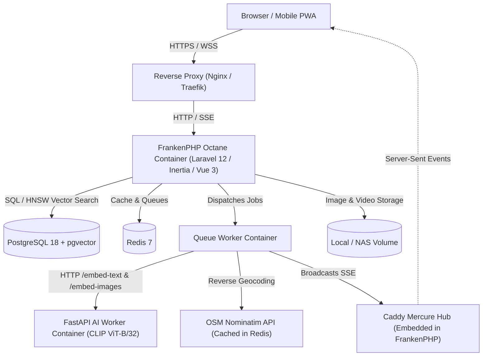

# Lumina

<div align="center">


### Modern, High-Performance Self-Hosted Photo & Video Gallery

[](https://kit.povshok.ge/)
[](LICENSE)
[](https://www.php.net/)
[](https://frankenphp.dev/)
[](https://vuejs.org/)
[](https://github.com/pgvector/pgvector)
[](https://web.dev/progressive-web-apps/)

**Explore your photo and video archives with natural language semantic search, interactive dark-mode maps, visual similarity discovery, and zero-latency real-time updates.**

[Explore Live Demo](https://kit.povshok.ge/) • [Key Features](#-key-features) • [Quick Start](#-quick-start) • [Deployment & Reverse Proxy](#-deployment--reverse-proxy) • [Configuration](#-configuration)

</div>

---

## ✨ Key Features

- **⚡ Blazing Fast Architecture:** Powered by **FrankenPHP** with **Laravel Octane** keeping the application resident in memory, backed by **Bun**-optimized Vite assets with fast client-side navigation via **Inertia.js v2**.
- **🧠 Local AI Semantic Search:** Natural language search powered by an on-premise **OpenAI CLIP (ViT-B/32)** worker container. Search for queries like *"sunset over the mountains"*, *"dog playing with ball"*, or *"coffee mug on wooden desk"* without sending your private photos to third-party cloud APIs.
- **✨ Visual Similarity Search:** Jump from any photo to visually similar images using cosine distance over 512-dimension vector embeddings in **pgvector HNSW** indexes.
- **🗺️ Interactive Geolocation & Dark Map:** Automatic GPS extraction with resilient ExifTool fallback, reverse geocoding via OpenStreetMap Nominatim (with 30-day Redis caching), and a custom dark Leaflet map view with marker clusters and instant photo previews.
- **📡 Real-Time Mercure SSE:** Instant scanning and processing progress broadcasted directly to the browser via Server-Sent Events without polling.
- **🔒 Security & UUIDv7 Identifiers:** Time-ordered, monotonic UUIDv7 public identifiers preventing sequential ID enumeration attacks while keeping integer keys optimized for internal database indexes.
- **🎞️ Cinematic Media Viewer:** Smooth touch gestures, pinch-to-zoom, keyboard navigation, context scrubber strip, EXIF details inspector, dominant-color blurry placeholders, and video streaming with HTTP byte-range seeking.
- **🛠️ Admin Panel (MoonShine v4):** Intuitive administration dashboard to manage storage sources, run scans, tag media, toggle feature flags, and manage soft-deleted tombstones.
- **📱 Progressive Web App (PWA):** Installable on iOS, Android, and Desktop with offline caching and background service workers.

---

## 🏛️ Architecture Overview



---

## 🚀 Quick Start

### Prerequisites
- Docker Engine 24.0+ and Docker Compose v2.20+
- At least 2 GB of RAM (4 GB recommended if running the AI CLIP worker)

### 1. Clone the repository
```bash
git clone https://github.com/eg00/Lumina.git
cd Lumina
```

### 2. Configure Environment
Copy the example environment file:
```bash
cp .env.example .env
```

Review `.env` and adjust the variables if needed:
```env
APP_PORT=8080
APP_PORT_SSL=8443
DB_PORT=5454
REDIS_PORT=6380
AI_WORKER_PORT=8001

ADMIN_EMAIL=admin@example.com
ADMIN_PASSWORD=change-this-password
ADMIN_NAME=Admin

INITIAL_MEDIA_PATH=/app/storage/app/public
```

### 3. Start Containers

#### Production (Pre-built GHCR Images — Recommended)
Run Lumina using official pre-built multi-arch images without compiling anything:
```bash
cp .env.prod.example .env
# Edit .env and set your secrets and photos folder path

docker compose -f docker-compose.prod.yml pull
docker compose -f docker-compose.prod.yml up -d
```

#### Development (Local Build & Live Code Reload)
```bash
cp .env.example .env
docker compose build
docker compose up -d
```

### 4. Initialize Lumina
Run the initialization command to create your admin account, apply migrations, and register your default media source:
```bash
docker compose exec app php artisan init
```

### 5. Scan Your Photos
Trigger your first media scan:
```bash
docker compose exec app php artisan media:scan
```

Open `http://localhost:8080` in your browser. Log in to the admin panel at `http://localhost:8080/admin` using your configured credentials.

---

## 🌐 Deployment & Reverse Proxy

In production, Lumina is typically deployed behind a reverse proxy handling SSL/TLS termination, HTTP/2/3, and gzip/brotli compression.

Because Lumina utilizes **Mercure Server-Sent Events (SSE)** for real-time scanner progress and **HTTP byte-range video streaming**, your reverse proxy must disable proxy buffering on streaming endpoints.

### 1. Nginx Configuration

Create a virtual host configuration (e.g. `/etc/nginx/sites-available/lumina.conf`):

```nginx
# Upstream to Lumina FrankenPHP Octane container
upstream lumina_backend {
    server 127.0.0.1:8080;
    keepalive 32;
}

server {
    listen 80;
    listen [::]:80;
    server_name gallery.yourdomain.com;

    # Redirect all HTTP requests to HTTPS
    return 301 https://$host$request_uri;
}

server {
    listen 443 ssl http2;
    listen [::]:443 ssl http2;
    server_name gallery.yourdomain.com;

    # SSL Certificate Paths (Let's Encrypt / Certbot)
    ssl_certificate /etc/letsencrypt/live/gallery.yourdomain.com/fullchain.pem;
    ssl_certificate_key /etc/letsencrypt/live/gallery.yourdomain.com/privkey.pem;
    ssl_protocols TLSv1.2 TLSv1.3;
    ssl_ciphers HIGH:!aNULL:!MD5;
    ssl_prefer_server_ciphers on;
    ssl_session_cache shared:SSL:10m;
    ssl_session_timeout 1d;

    # Large media upload support
    client_max_body_size 500M;
    client_body_buffer_size 128k;

    # Root proxy pass
    location / {
        proxy_pass http://lumina_backend;
        proxy_http_version 1.1;

        proxy_set_header Host $host;
        proxy_set_header X-Real-IP $remote_addr;
        proxy_set_header X-Forwarded-For $proxy_add_x_forwarded_for;
        proxy_set_header X-Forwarded-Proto $scheme;
        proxy_set_header X-Forwarded-Host $host;
        proxy_set_header X-Forwarded-Port $server_port;
        proxy_set_header Connection "";

        # Timeouts for video streaming and background operations
        proxy_connect_timeout 60s;
        proxy_send_timeout 300s;
        proxy_read_timeout 300s;
    }

    # Mercure Server-Sent Events (SSE) - Zero Buffering
    location /.well-known/mercure {
        proxy_pass http://lumina_backend;
        proxy_http_version 1.1;

        proxy_set_header Host $host;
        proxy_set_header X-Real-IP $remote_addr;
        proxy_set_header X-Forwarded-For $proxy_add_x_forwarded_for;
        proxy_set_header X-Forwarded-Proto $scheme;
        proxy_set_header Connection "";

        # Crucial for SSE real-time streaming
        proxy_buffering off;
        proxy_cache off;
        chunked_transfer_encoding off;
        proxy_read_timeout 24h;
    }

    # Static assets long-term caching
    location /build/ {
        proxy_pass http://lumina_backend;
        proxy_set_header Host $host;
        expires 1y;
        add_header Cache-Control "public, max-age=31536000, immutable";
    }
}
```

---

### 2. Traefik (v2 / v3) Configuration

If you manage your infrastructure with Traefik, add labels directly to the `app` service in `docker-compose.yml` or use a dynamic file provider.

#### Docker Compose Labels for Traefik:

```yaml
services:
  app:
    # ... existing app configuration ...
    labels:
      - "traefik.enable=true"
      
      # HTTP Router (Redirect to HTTPS)
      - "traefik.http.routers.lumina-http.rule=Host(`gallery.yourdomain.com`)"
      - "traefik.http.routers.lumina-http.entrypoints=web"
      - "traefik.http.routers.lumina-http.middlewares=redirect-to-https"
      - "traefik.http.middlewares.redirect-to-https.redirectscheme.scheme=https"

      # HTTPS Router
      - "traefik.http.routers.lumina-https.rule=Host(`gallery.yourdomain.com`)"
      - "traefik.http.routers.lumina-https.entrypoints=websecure"
      - "traefik.http.routers.lumina-https.tls=true"
      - "traefik.http.routers.lumina-https.tls.certresolver=letsencrypt"

      # Load Balancer & Port
      - "traefik.http.services.lumina.loadbalancer.server.port=80"
      
      # Buffering Middleware (Disabled for Mercure SSE & Streaming)
      - "traefik.http.routers.lumina-https.middlewares=lumina-compress,lumina-headers"
      - "traefik.http.middlewares.lumina-compress.compress=true"
      - "traefik.http.middlewares.lumina-headers.headers.customresponseheaders.X-Robots-Tag=noindex,nofollow,nosnippet,noarchive"
```

#### Traefik File Provider (`dynamic_conf.yml`):

```yaml
http:
  routers:
    lumina:
      rule: "Host(`gallery.yourdomain.com`)"
      service: lumina-svc
      entryPoints: ["websecure"]
      tls:
        certResolver: letsencrypt

  services:
    lumina-svc:
      loadBalancer:
        servers:
          - url: "http://127.0.0.1:8080"
        responseForwarding:
          flushInterval: "100ms" # Ensures SSE events flush immediately
```

---

## ⚙️ Configuration & Environment Variables

| Variable | Description | Default |
| :--- | :--- | :--- |
| `APP_PORT` | Host HTTP port for FrankenPHP Octane | `8080` |
| `APP_PORT_SSL` | Host HTTPS port | `8443` |
| `DB_CONNECTION` | Database driver | `pgsql` |
| `DB_HOST` | PostgreSQL container host | `db` |
| `DB_PORT` | PostgreSQL port | `5432` |
| `DB_DATABASE` | Primary database name | `lumina` |
| `REDIS_HOST` | Redis container host | `redis` |
| `MERCURE_PUBLIC_URL` | Public Mercure SSE hub URL accessed by browsers | `http://localhost:8080/.well-known/mercure` |
| `MERCURE_JWT_SECRET` | Secret key used to sign Mercure publish tokens | `random-secret-key` |
| `ADMIN_EMAIL` | Default administrator email for MoonShine | `admin@example.com` |
| `ADMIN_PASSWORD` | Default administrator password | *None* |
| `INITIAL_MEDIA_PATH` | Path inside container to scan for initial media | `/app/storage/app/public` |

---

## 🧠 AI Worker & Hardware Requirements

Lumina includes an isolated Python FastAPI microservice (`docker/ai-worker`) executing OpenAI's **CLIP ViT-B/32** model.

### Hardware Sizing
- **Full AI Stack (Recommended):** 4 GB RAM, 2+ CPU cores. Vector embeddings for images and natural language queries are computed locally.
- **Lightweight Mode:** 1.5 GB RAM. If your server is resource-constrained (e.g. 1 GB VPS or low-power NAS), you can toggle off AI features in the MoonShine Admin Panel (`Settings > Feature Flags > AI Semantic Search: OFF`). The app will smoothly fall back to text and date filtering.

### Artisan CLI Commands

| Command | Description |
| :--- | :--- |
| `php artisan init` | Idempotently creates admin user, default settings, and initial media source. |
| `php artisan media:scan` | Indexes media sources, generates WebP previews, extracts dominant colors & EXIF. |
| `php artisan media:scan {source_id}` | Scans a specific storage source by ID. |
| `php artisan media:reprocess-geo` | Re-extracts GPS via ExifTool and performs Nominatim reverse geocoding for all files. |

---

## 🧪 Testing & Code Quality

Lumina maintains strict quality standards:

```bash
# Run Pest test suite (51+ feature & unit tests with pgvector & Mercure fakes)
docker compose exec app php artisan test

# Run Laravel Pint code style verification
docker compose exec app ./vendor/bin/pint --test

# Run PHPStan static analysis at Level 8
docker compose exec app ./vendor/bin/phpstan analyse

# Run frontend formatting and linting (Biome / Vite+)
bun run check

# Build production assets
bun run build
```

---

## 🗺️ Roadmap

- [x] FrankenPHP Octane resident memory execution with Mercure SSE
- [x] Local CLIP AI vector search and similarity discovery via pgvector
- [x] Interactive Leaflet map & Nominatim geocoding
- [x] UUIDv7 public routing hardening against enumeration attacks
- [ ] Google Photos library import & automated sync integration
- [ ] Multi-user collections and shared secret links
- [ ] Face detection and person clustering
- [ ] On-the-fly HLS video transcoding for 4K HEVC/AV1 clips
- [ ] S3/B2 cloud storage driver support

---

## 📄 License

Lumina is open-source software licensed under the **GNU Affero General Public License v3.0 (AGPL-3.0)**. 
See the [LICENSE](LICENSE) file for more information.
